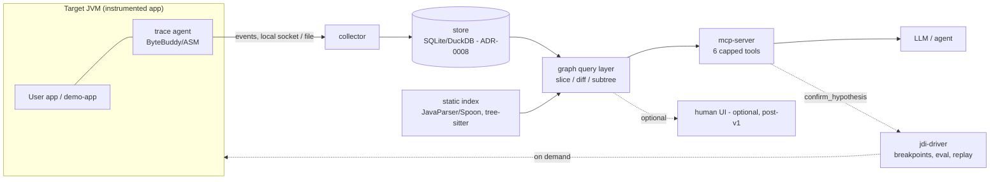

# Architecture

Decisions: [decisions/](decisions/README.md). Schema: [trace-schema.md](trace-schema.md).
Language/build: Kotlin + Gradle Kotlin DSL (ADR-0005). Target env: dev + CI (ADR-0001).

## Component diagram



## Components

| Component | Responsibility | Inputs → Outputs | Boundary / language | Failure behaviour |
|---|---|---|---|---|
| `agent/` | In-process probes: call/return/throw/assign/field-write/thread events; safe value summaries; redaction; ring buffer | Bytecode at load → event stream | Inside target JVM; Kotlin/Java, dependency-light, shaded | Never throws into app; on overload drops + counts events, records drop count; app runs on |
| `collector/` | Ingest, ordering, session/run management, write to store | Event stream → stored events | Own process (or CLI-embedded); Kotlin | Backpressure signal to agent; partial run marked incomplete, never silently whole |
| `store/` | Persistence + indexes; Parquet export TODO(decide) | Events → SQL tables ([trace-schema.md](trace-schema.md)) | Embedded DB file; Kotlin + JDBC | Corrupt/incomplete run flagged; event log is source of truth, indexes rebuildable |
| `graph/` | Graph derivation, `trace_back` slice, `diff_runs`, subtree queries, hierarchical summaries | Store → capped query results | Library used by mcp-server; Kotlin | Query over size cap → paginated/truncated result with cursor, never OOM |
| `jdi-driver/` | On-demand deep dive: breakpoints, watchpoints, expression eval, hypothesis replay | MCP request → JDI session results | Own process attached via JDWP; Kotlin (`jdk.jdi`) | Debuggee launch failure / timeout → structured error; sandboxed (security-privacy.md) |
| `mcp-server/` | The 6 tools; caps, pagination, auth (localhost token) | Graph/JDI → tool responses | Own process; Kotlin MCP SDK (TODO(verify) in stack.md) | Tool error = structured `{code,message,hint}`; never dumps raw graph |
| `eval/` | Baseline + TRACE agents over fixture corpora; metrics | Bugs → results table | CLI; Kotlin + scripts | Per-bug failure recorded, run continues |
| `demo-app/` | Seeded-bug Spring Boot service for spike + fixtures | HTTP load → failures | Own app (spec: demo-app-spec.md) | n/a — it is supposed to fail |
| static index (in `graph/`) | Map graph nodes ↔ source (class/method/line), code snippets for `get_source` | Sources/jars → index | Kotlin, JavaParser/Spoon | Missing source → bytecode location only, stated in result |

No dependency cycles: `agent` depends on nothing else; `store` ← `collector` ← `agent` events; `graph` → `store`; `mcp-server` → `graph`, `jdi-driver`; `eval` → everything via public surfaces; `demo-app` depends on nothing (agent attaches externally).

## Data flow: one investigation

1. Run finishes (or fails) under the agent; collector finalises run `R` in the store. Failure-triggered ring-buffer dump is included.
2. Agent (LLM) calls `get_failure_point(R)` → exception node, throwing location, immediate call context (capped).
3. LLM calls `trace_back(bad_value_or_exception, depth)` → backward slice: value-versions + producing statements, each with event IDs.
4. LLM calls `get_source(symbol)` for the implicated statements; optionally `get_call_subtree(inv)` to expand context, and `diff_runs(pass, fail)` if a passing run exists.
5. LLM forms one hypothesis citing event IDs (skill `debug-investigation`).
6. LLM calls `confirm_hypothesis(...)` → `jdi-driver` re-runs under JDI with breakpoint + condition; returns pass/fail evidence.
7. LLM writes the final report: root cause, evidence chain (event IDs), confidence, verification result (format in [llm-strategy.md](llm-strategy.md)). **No root-cause claim without step 6 or an explicit "unconfirmed" label.**

## Repo layout

```text
agent/       bytecode agent (ByteBuddy/ASM), capture, redaction, ring buffer
collector/   event ingest, run/session management
store/       SQL persistence, indexes, export
graph/       graph derivation, slice/diff queries, static source index
jdi-driver/  JDI deep-dive + confirm_hypothesis replay (sandboxed)
mcp-server/  MCP tools over graph/ + jdi-driver/
eval/        evaluation harness, baseline agent, fixtures registry
demo-app/    seeded-bug demo service (spec only until Phase 0)
docs/        these documents + decisions/
```

One line each above is the contract; a module may only depend on modules listed before it (no cycles).

## Supported platforms

| Axis | Support |
|---|---|
| Tool OS | Windows + Linux (dev/CI, ADR-0001). TODO(verify): macOS — question: needed for any Phase 0 contributor machine? |
| Tool JDK | TODO(verify): baseline JDK for running the tool itself (ADR-0005 open item) |
| Target (instrumented) app JDKs | **Proposed: 11, 17, 21, 25** — rationale: current LTS line a user app plausibly runs; Phase 0 verifies the agent on the demo app's JDK first, matrix expands in testing-ci.md |
| Defects4J corpus | Needs a Java 8 toolchain + Perl (see [evaluation.md](evaluation.md)); that JDK 8 need is for the corpus, not a promise to instrument Java 8 apps in v1. TODO(decide): instrument Java 8 targets? — question: any v1 user on Java 8? |

